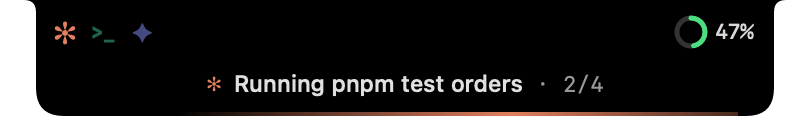
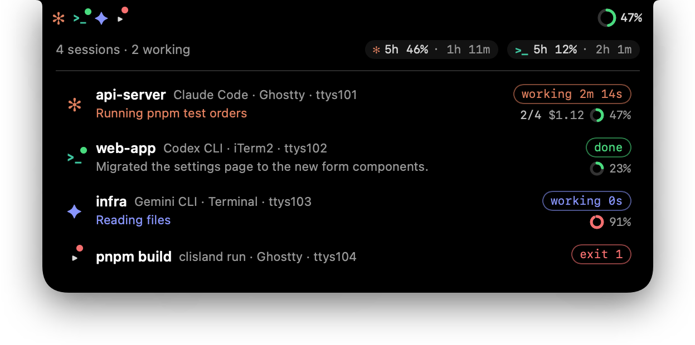
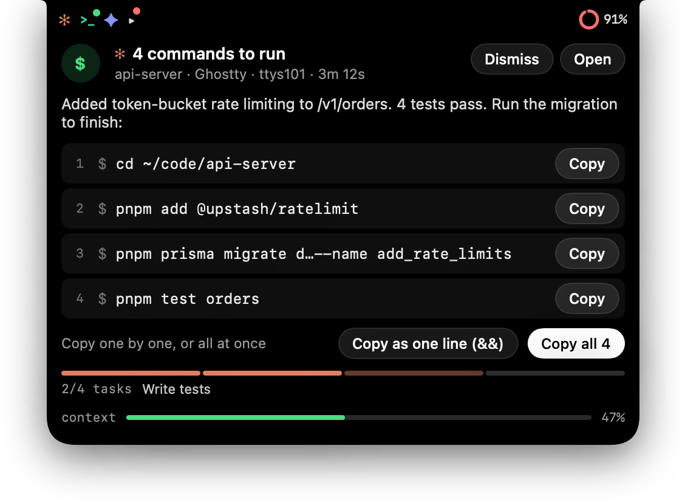
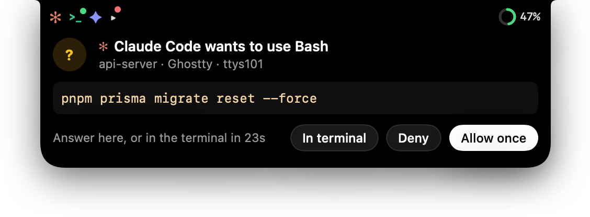
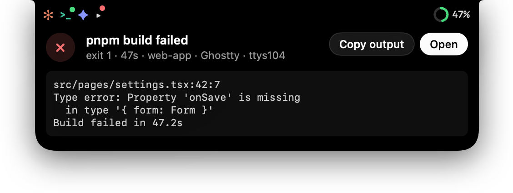
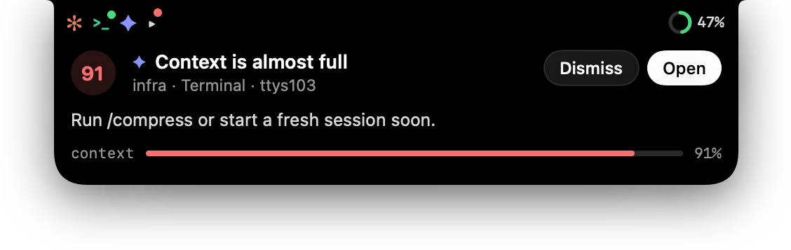

# CLIsland

Your coding agents, living in the MacBook notch.

CLIsland turns the notch into a status surface for **Claude Code**, **Codex CLI** and **Gemini CLI**. One glance tells you which terminal is working, which one finished, which one is waiting for approval, and how much context each session has left. Native Swift, runs locally, no accounts, no network.

<p align="center">
  
</p>

<p align="center">
  
</p>

## Features

| | What you see |
| --- | --- |
| **Live activity line** | “Running `pnpm test`”, “Editing `orders.ts`” under the notch while an agent works |
| **Task progress** | `2/4` and a segmented bar from Claude's todo list / tasks and Codex's plan |
| **Done notifications** | The notch drops open with a summary, duration and context left, then leaves a green dot |
| **Copyable commands** | Shell commands from the agent's last reply, each with **Copy**, plus **Copy all** and **Copy as one line (&&)** |
| **Approve from the notch** | Claude Code permission prompts get **Allow once / Deny / In terminal** |
| **Context warnings** | A ring per session; a nudge at 85% to `/compact` |
| **Usage limits** | Claude and Codex 5‑hour / weekly windows with reset countdowns, warning at 80% |
| **Stuck detector** | One nudge when a working session goes quiet for 5 minutes |
| **`clisland run`** | Wrap any long command: get notified with exit code, duration and the failing output |
| **Jump to terminal** | Click a session to focus its iTerm2 / Terminal tab (other terminals are brought to front) |

<p align="center">
  
  
</p>
<p align="center">
  
  
</p>

## Install

Requires macOS 14+ and the Xcode Command Line Tools (`xcode-select --install`). CLIsland builds from source on your Mac, so there is no Gatekeeper prompt.

**Homebrew**

```sh
brew tap nevinchanyi/clisland https://github.com/nevinchanyi/clisland
brew trust nevinchanyi/clisland      # newer Homebrew asks you to trust third-party taps
brew install clisland
clisland setup
```

**Install script**

```sh
curl -fsSL https://raw.githubusercontent.com/nevinchanyi/clisland/main/scripts/install.sh | bash
```

`clisland setup` detects which agent CLIs you have, adds its hooks, keeps everything else in your config, writes a backup to `~/.clisland/backups/`, and starts the app at login. Restart running agent sessions afterwards.

Try it without any agent running:

```sh
clisland demo
```

## What `setup` changes

| CLI | File | What is added |
| --- | --- | --- |
| Claude Code | `~/.claude/settings.json` | Async hooks for session, prompt, tool, task, stop and notification events; a blocking `PermissionRequest` hook; `statusLine` wrapped so your own status line keeps working |
| Codex CLI | `~/.codex/config.toml` | `notify = ["clisland", "emit", "--agent", "codex"]`. An existing notify program is kept and still runs |
| Gemini CLI | `~/.gemini/settings.json` | Hooks for `BeforeAgent`, `AfterAgent`, `BeforeTool`, `Notification`, session start and end |

Codex activity, plan steps, tokens and rate limits are read from `~/.codex/sessions/**/rollout-*.jsonl`; nothing is added for that.

Undo everything with `clisland uninstall` (add `--purge` to delete `~/.clisland`).

## Commands

```text
clisland setup [--only claude,codex,gemini] [--no-statusline] [--no-launch] [--dry-run]
clisland uninstall [--purge]
clisland start | stop | status | doctor | peek
clisland run -- <command>      notify when any long command finishes
clisland demo [--fast]         play fake sessions to preview the UI
```

`clisland run -- make build` runs the command in a pseudo-terminal, so colors and prompts work as usual.

## Settings

`~/.clisland/config.json` (also toggled from the menu bar icon):

| Key | Default | |
| --- | --- | --- |
| `sounds` | `true` | Glass when done, Submarine when it needs you, Basso on errors |
| `activity_line` | `true` | Show the live activity line under the notch |
| `approve_from_notch` | `true` | Answer Claude permission prompts from the notch |
| `approval_timeout` | `30` | Seconds before the prompt falls back to the terminal |
| `stuck_minutes` | `5` | Quiet time before the stuck nudge |
| `context_warn_pct` | `85` | Context warning threshold |
| `limit_warn_pct` | `80` | Usage limit warning threshold |
| `done_toast_seconds` | `6` | How long a done notification stays open |

## How it works

```text
Claude Code hooks + statusLine ┐
Codex notify + session files   ├─▶ clisland emit ─▶ ~/.clisland/clisland.sock ─▶ CLIsland (SwiftUI notch panel)
Gemini CLI hooks               ┘
```

- `clisland emit` is the hook entry point. It reads the hook JSON from stdin, adds the terminal (TTY, app, tmux pane), and sends one line to a local Unix socket. It takes ~8 ms and always exits 0, so it can never break your agent.
- Claude hooks run with `async: true`, so they never add latency to a turn. The permission hook is the only blocking one; it waits for your answer, up to `approval_timeout`.
- Nothing leaves your Mac. There is no telemetry.

## Notes and limits

- Approving from the notch works for Claude Code. Codex and Gemini prompts show as “needs you” with a jump to the terminal.
- Focusing an exact tab works in iTerm2 and Terminal.app (via AppleScript; macOS asks once for permission). Ghostty, Warp, kitty, WezTerm and VS Code are brought to the front. Inside tmux, the pane is selected first.
- Gemini context % assumes a 1M-token window.
- On Macs without a notch, CLIsland shows as a pill at the top center of the main screen.

## Development

```sh
swift build
swift test                      # needs the full Xcode toolchain for Swift Testing
.build/debug/clisland app       # run the notch app in the foreground
.build/debug/clisland demo --fast
.build/debug/clisland snapshot docs/images   # re-render README images
```

The core logic (hook parsing, command extraction, config patching) lives in `Sources/CLIslandCore` and is covered by tests. The app is in `Sources/clisland/App`.

## License

MIT
